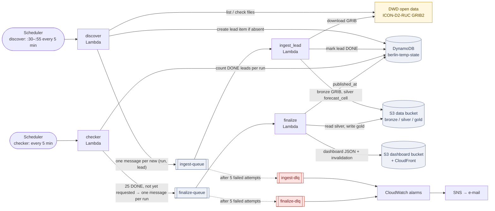
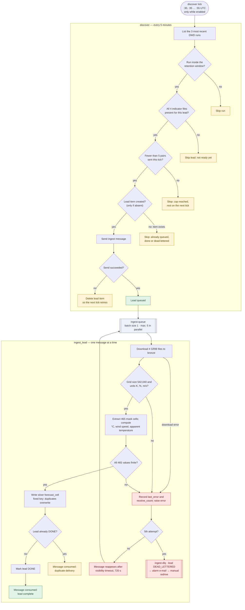
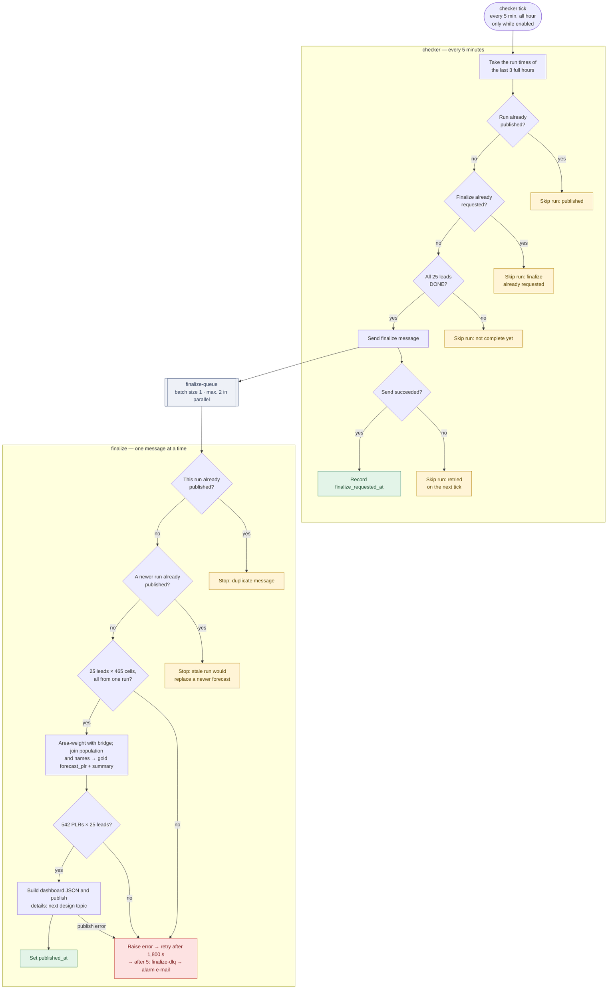

# Orchestration plan — Berlin temperature pipeline (AWS)

Status: draft for review (revision 2) · Scope: version 1 (25-point apparent-temperature forecast per PLR, population 65+, PLR names)

## Decisions this plan implements

| Topic | Decision |
|---|---|
| Orchestration | SQS + Lambda (no Step Functions) |
| Unit of work | One message per (run, lead); one finalize message per run |
| Retries | One mechanism only: SQS redelivery, `maxReceiveCount` = 5, then dead-letter queue (DLQ) |
| Failed messages | DLQ → alarm e-mail → manual investigation and redrive; no automatic redrive |
| State | DynamoDB: deduplication, lead status, finalize bookkeeping |
| Completeness | A separate **checker** Lambda on its own schedule (every 5 minutes, all hour, created disabled) decides when a run has all 25 leads DONE and queues finalize. Ingest workers only process leads; they do not count or hand off. |
| Duplicate finalize | Finalize is idempotent: it stops if the run is already published, so a duplicate finalize message is harmless |
| Stale runs | Finalize stops if a newer run is already published |
| Gold | Written once per run, by finalize, after the full horizon passes its checks |
| Static reference build | Separate Lambda, invoked manually, run once |
| Alerts | SNS e-mail: messages in a DLQ, no publication for 3 h, discover/finalize errors |

## System overview



## Flow logic: conditionals and blockers

Legend: **green** = success path ends, **amber** = intentional skip (normal, message is consumed), **red** = failure (retry, then DLQ and alarm).

discover evaluates each candidate (run, lead) in turn; an amber skip moves on to the next candidate, except "cap reached", which ends the tick. The checker evaluates each recent run in turn; every amber skip moves on to the next run.

### discover and ingest



### checker and finalize



## Components

| Name | Type | Purpose |
|---|---|---|
| `berlin-temp-discover` | EventBridge Scheduler | Fires at :30, :35 … :55 each hour (UTC). Created **disabled**; enabled only for tests and the 24–48 h run. |
| `discover` | Lambda | Finds ready (run, lead) pairs and queues new ones |
| `ingest-queue` / `ingest-dlq` | SQS | One message per (run, lead); after 5 failed attempts to the DLQ |
| `ingest_lead` | Lambda (triggered by `ingest-queue`) | bronze GRIB → silver `forecast_cell`; marks the lead DONE |
| `berlin-temp-checker` | EventBridge Scheduler | Fires every 5 minutes, all hour. Created **disabled**; enabled only for tests and the 24–48 h run. |
| `checker` | Lambda | Finds runs with all 25 leads DONE and queues finalize once per run |
| `finalize-queue` / `finalize-dlq` | SQS | One message per run |
| `finalize` | Lambda (triggered by `finalize-queue`) | silver → gold → dashboard publication |
| `berlin-temp-state` | DynamoDB, billed per request | Bookkeeping per run and lead |
| `berlin-temp-alerts` | SNS topic | E-mail to the budget-alert address |
| `reference_build` | Lambda, invoked manually | Static bronze → silver reference data, run once |

All Lambdas share one container image with different handlers.

## Messages

```json
ingest:   {"run_time": "2026-10-13T12:00Z", "lead": "PT005H"}
finalize: {"run_time": "2026-10-13T12:00Z"}
```

## DynamoDB items

| Key | Attributes |
|---|---|
| `PK=run#<run_time>`, `SK=lead#<lead>` | `status`: QUEUED / DONE / DEAD_LETTERED · `queued_at`, `done_at` · `receive_count`, `last_error` · `ttl` (7 days) |
| `PK=run#<run_time>`, `SK=meta` | `finalize_requested_at` · `published_at` · `ttl` |

## Step-by-step behavior

### discover (every 5 minutes, :30–:55)

1. List the 3 most recent runs from the temperature directory listing; ignore runs outside the retention window.
2. For each lead, check that all 4 indicator files exist.
3. For at most 5 new pairs per tick: create the lead item only if it does not exist (status QUEUED); on success, send the ingest message; if sending fails, delete the item so the next tick retries.

### ingest_lead (one message at a time)

1. Download the 4 GRIB files to `bronze/forecast/run=…/lead=…/`.
2. Decode; check grid size (542,040) and units (K, %, m/s).
3. Extract the 465 mask cells (mask loaded from silver once, reused while the Lambda stays warm).
4. Compute °C, wind speed and apparent temperature per cell; check all values are finite.
5. Write `silver/forecast_cell/run=…/lead=…/part.parquet` (fixed key: a duplicate run overwrites with identical content).
6. Set the lead to DONE only if it is not already DONE. A duplicate delivery finds it DONE and simply ends.
7. On error: record `last_error` and `receive_count`; on the 5th attempt set DEAD_LETTERED; re-raise so SQS retries or dead-letters the message.

### checker (every 5 minutes, all hour)

1. Take the run times of the last 3 full hours (UTC).
2. For each run: if `published_at` is set, skip; if `finalize_requested_at` is set, skip.
3. Count the run's DONE leads with a strongly consistent read; fewer than 25 → skip.
4. Send the finalize message; if sending fails, skip (the next tick tries again).
5. After a successful send, record `finalize_requested_at`. If the checker crashes between steps 4 and 5, the next tick sends a second message, which finalize ignores.

### finalize (one message at a time)

1. If `published_at` is set for this run, stop (duplicate message).
2. If a newer run is already published, stop (a late older run must not replace a newer forecast).
3. Read the 25 silver files; check 25 × 465 complete values from one run.
4. Load bridge, population and PLR names; aggregate to `gold/forecast_plr/run=…` (13,550 rows) and `gold/forecast_plr_summary/run=…`; check 542 × 25.
5. Build the dashboard JSON and publish (pointer object, bucket layout, CloudFront invalidation: next design topic).
6. Set `published_at`.

## Settings

| Setting | Value |
|---|---|
| Lambda timeouts | discover 60 s · checker 60 s · ingest 120 s · finalize 300 s (placeholders until measured) |
| Visibility timeout (≥ 6 × Lambda timeout) | ingest-queue 720 s · finalize-queue 1,800 s |
| `maxReceiveCount` | 5 (both queues) |
| DLQ message retention | 14 days |
| Batch size | 1 |
| Maximum concurrency of queue triggers | ingest 5 · finalize 2 (believed to be the minimum allowed; to verify) |
| Reserved concurrency | discover 1 · checker 1 |

## Monitoring

| Alarm | Condition |
|---|---|
| Ingest DLQ not empty | messages visible > 0 |
| Finalize DLQ not empty | messages visible > 0 |
| No publication | finalize invocations < 1 over 3 h; missing data counts as breaching |
| discover or finalize failing | Lambda errors > 0 |

- All alarms → SNS → e-mail.
- Structured JSON logs with `run_time`, `lead`, `receive_count` and duration, so CloudWatch Logs Insights can trace a lead end to end.
- Log retention 14 days on every log group (default is never expire, and stored logs are billed).

## Permissions (least privilege per function)

| Role | Allowed |
|---|---|
| schedulers | invoke `discover` / invoke `checker` (one role each) |
| discover | DynamoDB put/delete on the table · send to `ingest-queue` |
| ingest_lead | S3 write `bronze/forecast/` and `silver/forecast_cell/` · read silver reference data · DynamoDB update · consume `ingest-queue` |
| checker | DynamoDB query/get/update on the table · send to `finalize-queue` |
| finalize | S3 read `silver/`, write `gold/` · write dashboard bucket · CloudFront invalidation on that one distribution · DynamoDB get/update · consume `finalize-queue` |
| reference_build | S3 read/write `bronze/static/` · write silver reference data |

## Cost guards

- Both schedules disabled outside tests and the continuous run.
- discover sends at most 5 pairs per tick.
- Maximum concurrency on both queue triggers.
- No S3-event triggers anywhere, so no Lambda can trigger itself through its own output.
- DLQs end retries; no automatic redrive.
- Log retention set on all log groups.
- Existing AWS Budgets alerts remain as the backstop.
- Checker every 5 minutes: ≈ 8,600 invocations/month, within the Lambda and Scheduler free allowances (estimate from N. Virginia list prices; Frankfurt to be confirmed).

## Tests before the continuous run

1. Hand-written message to `ingest-queue` → check silver output and item status.
2. Same message twice → no duplicates, status correct.
3. Broken message (e.g. nonexistent lead) → 5 failures → DLQ → alarm e-mail → manual redrive works.
4. Checker with 25 DONE leads → exactly one finalize message; next tick sends none.
5. Two finalize messages for one run → exactly one publication.
6. Both schedules enabled for one hour → one full run end to end.

## Build order

Each step: try it once via the CLI, delete it, then build it with Terraform.

1. SNS topic + e-mail subscription
2. DynamoDB table
3. ECR repository with lifecycle policy, image, `ingest_lead` invoked manually
4. `ingest-queue` + DLQ + queue trigger
5. `discover` + schedule (created disabled)
6. `finalize-queue` + DLQ + `finalize`
7. `checker` + schedule (created disabled)
8. Alarms + log retention

## Details added with the checker (to confirm)

These fill in the checker decision and were not discussed individually:

- The checker examines the run times of the **last 3 full hours** (UTC), derived from the clock.
- It **sends the finalize message first, then records** `finalize_requested_at`. A crash in between causes at most a duplicate message, which finalize ignores.
- Once `finalize_requested_at` is set, the checker never requests that run again, even if it is not published. A failed finalize is handled by its DLQ and manual redrive.
- Checker settings: timeout 60 s, reserved concurrency 1. It is **not** included in the error alarm (only discover and finalize are).

## Known limitations (accepted)

- **discover crash between creating the lead item and sending the ingest message.** The item says QUEUED but no message exists, so the lead is never processed and its run never reaches 25 DONE leads. The undo step covers a failed send, not a crash. Accepted for version 1; the only signal is the "no publication for 3 h" alarm. Recovery: delete the stuck lead item by hand so the next discover tick queues it again.

## Open items

- Publication details (pointer object, dashboard bucket layout, CloudFront invalidation) — next design topic.
- Timeouts and memory sizes measured on real runs.
- Current prices for Lambda, SQS, DynamoDB, EventBridge Scheduler, CloudWatch before building.
- Verify: minimum maximum-concurrency value for SQS triggers.
